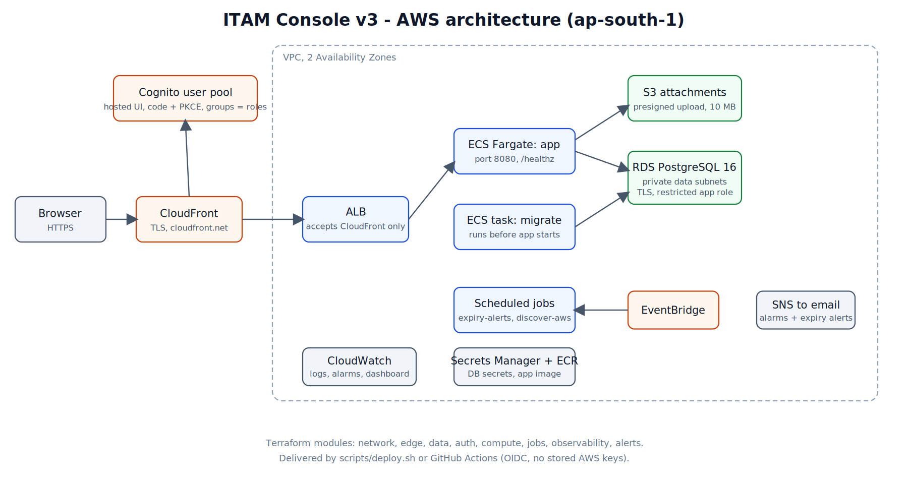

# ITAM Console

**IT asset management on AWS.** Track assets, licenses and support tickets, attach files, and keep a full audit trail. Runs on ECS Fargate behind CloudFront, with Cognito sign-in and RDS PostgreSQL. The whole environment is built with Terraform and shipped with one script or a GitHub Actions pipeline.



> **Status:** application, tests and Terraform are verified (see [Verification](#verification)). Live AWS evidence is listed in [Screenshots](#screenshots) once captured.

## Highlights

- **Full-stack app:** TanStack Start (React 19) with server functions, Node 22, Drizzle ORM, Zod validation, Tailwind and Recharts dashboards.
- **Real authorization:** Cognito hosted sign-in (authorization code + PKCE), httpOnly cookies, roles from Cognito groups (viewer, technician, admin) enforced server-side on every call.
- **Auditability:** every change writes an `audit_log` row with before/after in the same database transaction.
- **Secure by design:** ALB accepts only CloudFront, database in private subnets with TLS and a least-privilege app role, CSRF origin checks, presigned S3 uploads (10 MB, type allow-list), no AWS keys in CI (GitHub OIDC).
- **Infrastructure as code:** 8 Terraform modules (network, edge, data, auth, compute, jobs, observability, alerts) with `demo` and `prod` environments that differ in one place.
- **Operations built in:** CloudWatch logs, alarms and dashboard, SNS email alerts, daily license/warranty expiry alerts, optional nightly EC2 discovery, budget alarm, rolling deploys with automatic rollback.
- **Tested:** 43 automated tests, including integration tests against real PostgreSQL 16.

## Tech stack

| Layer | Technology |
|---|---|
| App | TanStack Start, React 19, TypeScript, Node 22, Drizzle ORM, Zod, Tailwind CSS 4 |
| Auth | Amazon Cognito (hosted UI, PKCE), `aws-jwt-verify` |
| Compute | ECS Fargate, ECR, EventBridge Scheduler (jobs) |
| Data | RDS PostgreSQL 16, S3 (attachments), Secrets Manager |
| Edge | CloudFront, Application Load Balancer, optional WAF (prod) |
| Observability | CloudWatch Logs, alarms, dashboard, SNS |
| IaC / CI | Terraform >= 1.10, tflint, GitHub Actions (OIDC), Docker |

## Repository layout

```
app/      Web app, server functions, worker jobs, SQL migrations, Dockerfile, tests
infra/    Terraform: bootstrap/ (state + CI trust), modules/, envs/demo, envs/prod
scripts/  first-deploy, deploy, rollback, create-user
docs/     architecture, runbook, security, migration from v2, portfolio kit
.github/  CI, plan on pull request, deploy
```

## Features

| | viewer | technician | admin |
|---|:--:|:--:|:--:|
| View assets, tickets, licenses, attachments | yes | yes | yes |
| Raise a ticket | yes | yes | yes |
| Update tickets, create/edit assets, upload attachments | | yes | yes |
| Delete assets/attachments, manage licenses, view audit log | | | yes |

## Run locally (about 5 minutes, no AWS needed)

Requirements: Node 22+, Docker.

```bash
cd app
docker compose up -d db                 # PostgreSQL 16
cp .env.local.example .env.local        # PowerShell: Copy-Item .env.local.example .env.local
npm ci
npm run db:migrate && npm run db:seed
npm run dev                             # http://localhost:8080
```

Use **Dev sign-in** on the sign-in page to pick a role. `DEV_AUTH=1` is refused when `NODE_ENV=production`. File upload needs S3, so it only works after an AWS deploy.

```bash
npm run typecheck && npm run lint && npm test
```

## Deploy to AWS

Requirements: AWS account, AWS CLI configured, Terraform >= 1.10, Docker, jq. Run scripts from Git Bash on Windows.

```bash
# 1. once per account: Terraform state bucket + GitHub OIDC trust
cd infra/bootstrap && terraform init && terraform apply -var github_repo=<owner>/<repo>

# 2. configure the demo environment
cd ../envs/demo
cp backend.hcl.example backend.hcl            # state bucket name
cp terraform.tfvars.example terraform.tfvars  # admin and alert emails

# 3. infra + image push + migration + start + seed (safe to re-run)
cd ../../.. && bash scripts/first-deploy.sh demo
```

Later releases: `bash scripts/deploy.sh demo`, rollback with `bash scripts/rollback.sh demo`, add a user with `bash scripts/create-user.sh demo user@example.com technician`. Details and troubleshooting: [docs/RUNBOOK.md](docs/RUNBOOK.md).

## Architecture and security

- [docs/ARCHITECTURE.md](docs/ARCHITECTURE.md): request path, network tiers, roles, data model, environments.
- [docs/SECURITY.md](docs/SECURITY.md): security decisions.
- Network: public subnets (ALB), private app subnets, private data subnets (RDS, no internet route). Demo skips NAT to save cost; tasks sit behind a security group that only accepts the ALB.

## Verification

Run on a clean checkout (2026-10-24):

- `npm ci`, `typecheck`, `lint` and production `build` pass.
- 43 tests pass, including 5 integration tests against real PostgreSQL 16 (migrations, idempotency, restricted role cannot alter the schema).
- Migrations and seed applied; the local server returns 200 on `/healthz` and `/signin`.
- Terraform: `fmt` and `tflint` clean, `validate` succeeds, resource arguments checked against the AWS provider 5.99 schema.

Not covered by automated checks: a real Cognito sign-in, browser S3 upload, CloudFront/ALB routing and ECS scheduling. These need a live deploy; see [docs/RUNBOOK.md](docs/RUNBOOK.md).

## Screenshots

Add real captures to `docs/screenshots/` using the names in [CAPTURE-CHECKLIST.md](docs/screenshots/CAPTURE-CHECKLIST.md), then uncomment:

<!--
| Dashboard | Assets |
|---|---|
|  |  |

| ECS service | CloudWatch dashboard |
|---|---|
|  |  |
-->

## Cost and cleanup

Approximate, ap-south-1, always on: **demo about $45-55/month** (ALB and public IPv4 addresses dominate), prod about $140-180 (NAT, multi-AZ RDS, two tasks, WAF). These are estimates; check current prices. A Budgets alarm is created per environment.

Stop charges after demonstrating:

```bash
cd infra/envs/demo && terraform destroy
```

The state bucket from `bootstrap` is kept on purpose (cents per month).

## Known limitations

- No custom domain: CloudFront to ALB is HTTP inside AWS (the ALB only accepts CloudFront). A domain and ACM certificate would make that hop HTTPS.
- Cognito MFA is pool-wide (prod requires it for everyone).
- The deploy role is AdministratorAccess because Terraform creates IAM and KMS; it is protected by the OIDC trust policy (main branch, protected environments).

## What I learned

Designing least-privilege access between ALB, tasks, RDS and S3; running migrations safely before rollout; reading Terraform plan JSON (`after_unknown` for values known only after apply); and debugging real deployment failures such as ECR login on Windows and first-deploy ordering. More: [docs/PORTFOLIO.md](docs/PORTFOLIO.md).

## Author

**Shivang Chaurasia**, final-year B.Tech IT student, BBDITM Lucknow, targeting Cloud Engineer roles (AWS, Terraform).
[LinkedIn](https://linkedin.com/in/shivang-chaurasia)
