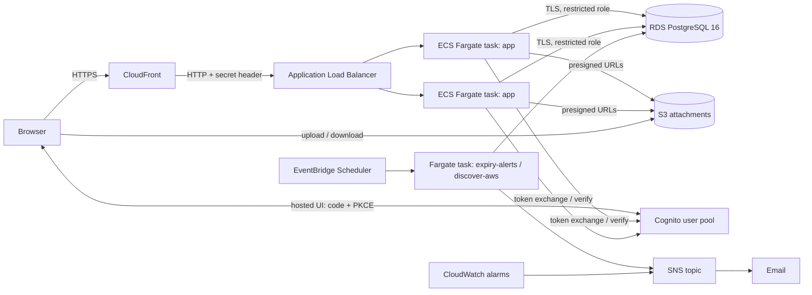

# Architecture

## Network
Three subnet tiers in two AZs: **public** (ALB, NAT), **private-app** (tasks, prod), **private-data** (RDS, no route to the internet).
Demo has no NAT: tasks run in public subnets with a public IP, but their security group only accepts the ALB, so they are not reachable from the internet.

## Request path and trust
1. CloudFront terminates TLS. The ALB security group allows only CloudFront's address range **and** the listener requires a secret header; anything else gets 403.
2. The app verifies the Cognito id token (signature, issuer, audience, expiry) on every call. Roles come from the `cognito:groups` claim; there is no role table to drift out of sync.
3. Every server function declares the permission it needs. Mutations write an `audit_log` row in the same transaction.
4. Browser cookies are httpOnly, Secure, SameSite=Lax; state-changing requests are also rejected when `Origin` differs from the public URL.

## Roles
| | viewer | technician | admin |
|---|---|---|---|
| view assets, tickets, licenses, attachments | yes | yes | yes |
| raise ticket | yes | yes | yes |
| update ticket, create/edit asset, upload attachment | | yes | yes |
| delete asset/attachment, manage licenses, view audit log | | | yes |

## Data
`profiles`, `assets` (tag from a sequence, optional `source`+`external_id` for discovered assets), `tickets`, `licenses`, `attachments`, `audit_log`, `alert_log` (so each 30/14/7-day alert is sent once).
Migrations are SQL files in `app/drizzle/`, applied by a one-off Fargate task before each rollout. Keep them backwards compatible (add first, remove later) so rollback stays safe.

## Environments
`infra/modules/stack` is the entire platform. `locals.mode` is the only place demo and prod differ (NAT, task count and size, multi-AZ, WAF, KMS key, log retention, MFA).

## Known limits
- No custom domain: the app lives on the `*.cloudfront.net` name. CloudFront to ALB is HTTP inside AWS (the ALB only accepts CloudFront). Add a domain + ACM certificate to make that leg HTTPS.
- Cognito MFA is pool-wide: prod sets it to ON for everyone (stricter than "admins only").
- The deploy role is AdministratorAccess because Terraform creates IAM and KMS; protection comes from the trust policy (main branch, protected GitHub Environments).
