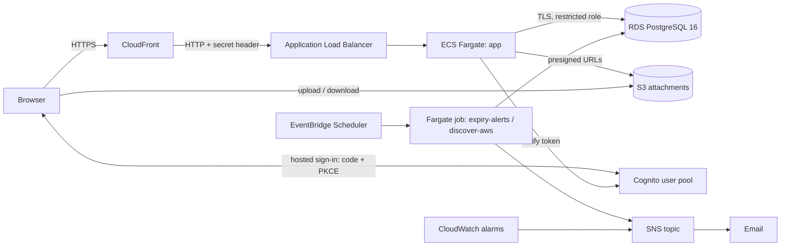

# ITAM Console: Project Documentation

**IT Asset Management platform on AWS** | Version 3.0 | Author: Shivang Chaurasia (B.Tech IT, BBDITM Lucknow)

## Table of contents

1. [Overview](#1-overview)
2. [Features](#2-features)
3. [How it works (architecture)](#3-how-it-works-architecture)
4. [Technology stack](#4-technology-stack)
5. [Data model](#5-data-model)
6. [Security](#6-security)
7. [Repository structure](#7-repository-structure)
8. [Run it locally](#8-run-it-locally)
9. [Deploy it to AWS](#9-deploy-it-to-aws)
10. [Using the application](#10-using-the-application)
11. [Operations](#11-operations)
12. [Testing and CI/CD](#12-testing-and-cicd)
13. [Cost and cleanup](#13-cost-and-cleanup)
14. [Verification status](#14-verification-status)
15. [Known limitations and roadmap](#15-known-limitations-and-roadmap)
16. [Glossary](#16-glossary)
17. [Credits](#17-credits)

---

## 1. Overview

### The problem
Organisations lose track of laptops, servers and software licenses. Warranties and licenses expire unnoticed, support requests have no history, and nobody can say who changed what.

### The solution
ITAM Console is a web application where IT staff:
- keep an **inventory** of hardware (every asset gets a serial-tagged record),
- raise and track **support tickets** against specific assets,
- track **software licenses** (seats used vs owned, renewal dates),
- attach **files** (invoices, warranty PDFs, photos) to assets,
- and rely on a full **audit log** of every change.

Users sign in through **Amazon Cognito**. What they can do depends on their role: viewer, technician or admin.

### What makes it a cloud project
The whole environment is created by **Terraform** (infrastructure as code) and runs on **AWS managed services**: ECS Fargate, RDS PostgreSQL, S3, CloudFront, Cognito, CloudWatch. One script deploys it; a GitHub Actions pipeline can do the same without stored AWS keys.

---

## 2. Features

| Area | What it does |
|---|---|
| Dashboard | Total assets, status chart, ticket queue, latest tickets, licenses nearing expiry |
| Assets | Add, edit, search and filter (in stock, assigned, in repair, retired); automatic tag `AST-000001`; warranty date; assigned-to and location |
| Tickets | Raise a ticket against an asset with priority (low to critical); status flow: open, in progress, resolved, closed |
| Licenses | Product, vendor, seats total and used, annual cost, expiry date |
| Attachments | Upload files up to 10 MB to an asset; downloads use short-lived links |
| Audit log | Who did what and when; written in the same database transaction as the change |
| Alerts | Scheduled job emails (via SNS) when a license or warranty is 30, 14 or 7 days from expiry; each alert is sent once |
| Discovery | Optional nightly job that imports EC2 instances as assets |
| Roles | viewer, technician, admin, enforced on the server |

### Permission matrix

| Action | viewer | technician | admin |
|---|:--:|:--:|:--:|
| View assets, tickets, licenses, attachments | yes | yes | yes |
| Raise a ticket | yes | yes | yes |
| Update a ticket, create/edit an asset, upload an attachment | | yes | yes |
| Delete an asset or attachment, manage licenses, view audit log | | | yes |

---

## 3. How it works (architecture)




### Request flow
1. The browser opens the CloudFront URL (TLS ends here).
2. CloudFront forwards to the Application Load Balancer. The ALB accepts only CloudFront and a secret header; anything else gets 403.
3. The ALB sends the request to a Fargate task running the web app (port 8080, health check `/healthz`).
4. The app checks the Cognito token on every call, checks the user's role, then reads or writes PostgreSQL.
5. Every change also writes a row to `audit_log` in the same transaction.
6. File uploads go straight from the browser to S3 using a presigned URL created by the app.

### Network design
Three subnet tiers across two Availability Zones:

| Tier | Contains | Internet |
|---|---|---|
| Public | ALB (and NAT in prod) | yes |
| Private app | Fargate tasks (prod) | via NAT |
| Private data | RDS | none |

The **demo** environment skips NAT to save cost: tasks sit in public subnets with a public IP, but their security group accepts traffic only from the ALB.

### Demo vs prod
`infra/modules/stack` is the entire platform. One block, `locals.mode`, is the only difference between environments:

| Setting | demo | prod |
|---|---|---|
| App tasks | 1 (0.25 vCPU, 512 MB) | 2 (0.5 vCPU, 1 GB) |
| NAT gateway | none | yes |
| RDS | single AZ, 1-day backups | multi-AZ, 7-day backups, deletion protection |
| WAF, KMS key, required MFA | off | on |
| Log retention | 14 days | 90 days |
| Default budget alarm | $60 | $150 |

---

## 4. Technology stack

| Layer | Technology | Why |
|---|---|---|
| Frontend + server | TanStack Start, React 19, TypeScript, Node 22 | Single codebase, typed server functions |
| Database access | Drizzle ORM, SQL migrations, Zod validation | Type safety, reviewable migrations |
| UI | Tailwind CSS 4, Recharts | Fast styling, charts |
| Authentication | Amazon Cognito (hosted UI, authorization code + PKCE) | No passwords stored by the app |
| Compute | ECS Fargate, ECR | No servers to patch, rolling deploys with rollback |
| Database | RDS PostgreSQL 16 | Managed backups and patching |
| Storage | S3 | Private, versioned attachment bucket |
| Edge | CloudFront, ALB | HTTPS without owning a domain |
| Monitoring | CloudWatch logs, alarms, dashboard; SNS email | Alerts reach the admin |
| Scheduling | EventBridge Scheduler | Expiry alerts, discovery |
| Infrastructure as code | Terraform 1.10+ (8 modules) | Repeatable, reviewable |
| CI/CD | GitHub Actions (OIDC), Docker, Trivy, tflint, gitleaks | Checks on every change, no stored AWS keys |

---

## 5. Data model

| Table | Purpose |
|---|---|
| `profiles` | Display name and email of each signed-in user |
| `assets` | Hardware records: tag (from a sequence), name, serial, category, status, assigned to, location, warranty end; optional `source` + `external_id` for discovered assets |
| `tickets` | Issue, priority, status, linked asset, raised by |
| `licenses` | Product, vendor, seats total/used, annual cost, expiry |
| `attachments` | File metadata and S3 key for each upload |
| `audit_log` | Actor, action, entity, before/after detail, timestamp |
| `alert_log` | Remembers which expiry alerts were sent, so each goes out once |

Migrations are SQL files in `app/drizzle/`. They run as a one-off Fargate task **before** each rollout, so a failed migration never reaches the running app. Keep migrations backwards compatible (add first, remove later) so rollback stays safe.

---

## 6. Security

| Control | Detail |
|---|---|
| Authentication | Cognito hosted sign-in, authorization code + PKCE; password policy of 12+ characters with a symbol |
| Authorization | Roles come from Cognito groups; every server function declares the permission it needs |
| Session | httpOnly, Secure, SameSite=Lax cookies; state-changing requests rejected if `Origin` differs from the public URL |
| Network | ALB reachable only through CloudFront; RDS in private data subnets with no internet route; task security group accepts only the ALB |
| Database | TLS verified against the RDS CA bundle; the app uses a restricted role that cannot create, alter or drop schema objects (covered by an integration test) |
| Secrets | In Secrets Manager, injected at start; none in the repository or image |
| Uploads | Presigned POST with exact content type, 1 byte to 10 MB, fixed key, 5-minute expiry; downloads via 60-second presigned GET; bucket private, versioned, TLS-only |
| CI/CD | GitHub OIDC short-lived credentials; deploy role assumable only from the `demo` and `prod` GitHub Environments |
| Scanning | Trivy (image and Terraform), gitleaks, `npm audit` (gate: critical) |
| Audit | Immutable record of changes, written in the same transaction |

More detail: [SECURITY.md](SECURITY.md).

---

## 7. Repository structure

```
itam-console/
├── app/                    Web app (TypeScript)
│   ├── src/routes/         Pages: dashboard, assets, tickets, licenses, audit, sign-in
│   ├── src/api/            Server functions (assets, tickets, licenses, attachments, ...)
│   ├── src/server/         Auth, database, CSRF, storage, config
│   ├── src/worker/         Migrate, seed and scheduled jobs
│   ├── drizzle/            SQL migrations
│   ├── tests/              43 automated tests
│   ├── Dockerfile          Production image
│   └── docker-compose.yml  Local PostgreSQL
├── infra/
│   ├── bootstrap/          Terraform state bucket + GitHub OIDC roles (run once)
│   ├── modules/            network, edge, data, auth, compute, jobs, observability, alerts, stack
│   └── envs/demo, prod     Environment entry points
├── scripts/                first-deploy, deploy, rollback, create-user, current-image-tag
├── docs/                   Architecture, runbook, security, this documentation, screenshots
└── .github/workflows/      ci, plan, deploy
```

---

## 8. Run it locally

**Requirements:** Node 22+, Docker Desktop, Git. No AWS account needed.

```powershell
cd C:\Users\shiva\itam-console-aws\app
docker compose up -d db
Copy-Item .env.local.example .env.local
npm ci
npm run db:migrate
npm run db:seed
npm run dev
```

Open `http://localhost:8080`, choose **Dev sign-in**, pick a role. Dev sign-in is refused when `NODE_ENV=production`. File upload needs S3, so it works only after an AWS deploy.

If port 5432 is already used, change `5432:5432` to `5433:5432` in `docker-compose.yml` and set `DB_PORT=5433` in `.env.local`.

Run the checks:
```powershell
npm run lint
npm run typecheck
$env:DB_HOST="localhost"; $env:DB_PORT="5432"; $env:DB_NAME="itam"
$env:DB_USER="itam_master"; $env:DB_PASSWORD="devpass"; $env:DB_SSL="off"
npm test
```
The integration test resets the local database, so run `npm run db:migrate` and `npm run db:seed` again afterwards.

---

## 9. Deploy it to AWS

**Requirements:** AWS account, AWS CLI configured (`aws configure`, region `ap-south-1`), Terraform 1.10+, Docker, jq, Git Bash on Windows. Use an IAM user with the permissions Terraform needs (it creates IAM roles, VPC and KMS).

### Step 1: bootstrap (once per AWS account, PowerShell)
```powershell
cd infra\bootstrap
"github_repo = `"<owner>/<repo>`"" | Set-Content terraform.tfvars -Encoding ascii
terraform init
terraform apply
```
Creates the Terraform state bucket and the GitHub OIDC roles. If resources already exist, import them (see [TROUBLESHOOTING.md](TROUBLESHOOTING.md)).

### Step 2: configure the environment (PowerShell)
```powershell
cd ..\envs\demo
@"
bucket = "<state-bucket-name>"
region = "ap-south-1"
"@ | Set-Content backend.hcl -Encoding ascii
@'
region      = "ap-south-1"
admin_email = "you@example.com"
alert_email = "you@example.com"
'@ | Set-Content terraform.tfvars -Encoding ascii
```
Use a real inbox for `admin_email`: the temporary password is sent there. Do not edit these files in Notepad (it adds `.txt`).

### Step 3: first deploy (Git Bash, not PowerShell)
```bash
cd /c/Users/<you>/itam-console-aws
export MSYS_NO_PATHCONV=1
bash scripts/first-deploy.sh demo
```
The script: creates the infrastructure (15 to 25 min), builds and pushes the image to ECR, runs the database migration, starts the app, runs a health check, then loads sample data. It is safe to re-run after a failure. Do not press Ctrl+C while it runs. Total time: 40 to 60 minutes.

### Step 4: sign in
1. Check your inbox for the Cognito temporary password and the SNS "Confirm subscription" email.
2. Open the printed `https://<id>.cloudfront.net` URL and sign in; set a new password.

### Later releases
```bash
bash scripts/deploy.sh demo                                  # new version
bash scripts/rollback.sh demo                                # previous version
bash scripts/create-user.sh demo person@example.com technician
```

### Deploy from GitHub Actions (optional)
Set these repository **variables** (Settings, Secrets and variables, Actions, Variables) and create a GitHub Environment named `demo`:

| Variable | Value |
|---|---|
| `AWS_DEPLOY_ROLE_ARN` | `terraform output github_deploy_role_arn` from `infra/bootstrap` |
| `TF_STATE_BUCKET` | the state bucket name |
| `AWS_REGION` | `ap-south-1` |
| `ADMIN_EMAIL`, `ALERT_EMAIL` | the same values as in `terraform.tfvars` |

Then run **Actions, deploy, Run workflow**.

---

## 10. Using the application

A short end-user guide is in [USER-GUIDE.md](USER-GUIDE.md). In summary:

1. **Sign in** with your company account. First time: use the temporary password, then set a new one.
2. **Dashboard** shows what needs attention.
3. **Assets**: click *Add asset*, fill in name, serial, category, status and (optionally) assignee, location and warranty date. Open an asset to edit it or upload files.
4. **Tickets**: click *Raise ticket*, choose the asset, describe the issue, set the priority. Technicians change the status as work progresses.
5. **Licenses** (admin): add products and seat counts; the expiry date drives the alert emails.
6. **Audit log** (admin): review who changed what.

---

## 11. Operations

| Task | Command or place |
|---|---|
| App logs | `aws logs tail /itam/itam-demo/app --since 30m --follow` |
| Migration logs | `/itam/itam-demo/migrate` in CloudWatch |
| Health check | `https://<cloudfront-url>/healthz` |
| Roll back | `bash scripts/rollback.sh demo` |
| Add a user | `bash scripts/create-user.sh demo person@example.com viewer` |
| Change a role | Move the user between Cognito groups; applies at next sign-in (token lifetime 60 min) |
| Run a job now | `aws ecs run-task` with the job's task definition (see [RUNBOOK.md](RUNBOOK.md)) |
| Restore the database | RDS point-in-time restore creates a new instance (see RUNBOOK) |
| Monitoring | CloudWatch dashboard `itam-demo`; alarms notify the alert email through SNS |

Full procedures and failure table: [RUNBOOK.md](RUNBOOK.md).

---

## 12. Testing and CI/CD

### Tests
43 automated tests (Vitest): role permissions, CSRF origin checks, input schemas, Cognito token handling, S3 upload rules, expiry-alert logic, and 5 integration tests against a real PostgreSQL 16 (migrations, idempotent discovery, restricted database role).

### Pipelines (`.github/workflows`)

| Workflow | Trigger | Does |
|---|---|---|
| `ci` | push to main, pull request | lint, typecheck, build, tests with PostgreSQL, `npm audit` (critical), image build and Trivy scan, `terraform fmt/validate`, tflint, Terraform Trivy scan (report only), gitleaks |
| `plan` | pull request | `terraform plan` using the read-only role |
| `deploy` | manual | build, push, migrate and roll out through the `demo` or `prod` GitHub Environment |

---

## 13. Cost and cleanup

Approximate, ap-south-1, always on. These are estimates; check current AWS prices.

| Environment | Estimate | Main drivers |
|---|---|---|
| demo | about $45 to $55 per month (roughly $1.50 to $2 per day) | ALB, public IPv4 addresses, RDS, Fargate |
| prod | about $140 to $180 per month | adds NAT, multi-AZ RDS, second task, WAF |

A budget alarm is created per environment. **To stop all charges after a demonstration:**
```powershell
cd infra\envs\demo
terraform destroy
```
Type `yes`; it takes 15 to 20 minutes. The state bucket from `bootstrap` is kept on purpose (cents per month).

---

## 14. Verification status

| Item | Status | Evidence |
|---|---|---|
| Typecheck, lint, production build | Verified | run on a clean checkout |
| 43 automated tests (incl. real PostgreSQL) | Verified | `docs/screenshots/01-tests-passing.png` |
| Deployed to AWS (demo, ap-south-1) | Verified | `docs/screenshots/21-terraform-apply-complete.png`, `22-deploy-smoke-test-healthy.png` |
| Cognito sign-in and password change | Verified | screen recording |
| Dashboard, assets, tickets, licenses, audit log on live URL | Verified | screenshots 02 to 08 |
| File upload to S3 | Verified | `17-s3-attachment-pdf.png` |
| ECS, ALB, CloudFront, RDS, VPC, Cognito, SNS | Verified | screenshots 10 to 19 |
| Scheduled expiry alerts and discovery job running on schedule | Not yet demonstrated | |
| Viewer role blocked from admin actions on the live site | Not yet demonstrated (covered by unit tests) | |
| Automated deploy from GitHub Actions | Configured, depends on repository variables | |

---

## 15. Known limitations and roadmap

**Limitations**
- No custom domain: the app is on the `*.cloudfront.net` name and CloudFront to ALB is HTTP inside AWS (the ALB accepts only CloudFront).
- Cognito MFA is pool-wide, and required for everyone in prod.
- The deploy role is AdministratorAccess, because Terraform creates IAM and KMS. Protection comes from the trust policy.
- `zod` 3.x is flagged by `npm audit` (memory exhaustion on oversized collections); the fix needs zod 4 (breaking), so CI gates on critical until that migration.
- The Terraform security scan in CI is report-only because the demo skips NAT and WAF on purpose.

**Roadmap**
1. Custom domain and ACM certificate, HTTPS to the ALB.
2. Least-privilege deploy role.
3. Migrate to zod 4.
4. Browser end-to-end tests.
5. VPC endpoints for ECR, Logs and Secrets in prod; GuardDuty; SNS encryption with a customer key.

---

## 16. Glossary

| Term | Meaning |
|---|---|
| ALB | Application Load Balancer; spreads traffic across app tasks |
| CloudFront | AWS content delivery network; gives the app its HTTPS URL |
| Cognito | AWS sign-in and user management service |
| ECS Fargate | Runs containers without managing servers |
| ECR | AWS container image registry |
| RDS | Managed relational database service |
| OIDC | Open standard letting GitHub prove its identity to AWS without stored keys |
| PKCE | Extra protection for the sign-in code flow |
| Terraform | Tool that builds cloud infrastructure from code |
| Presigned URL | Short-lived link that allows one specific upload or download |
| Audit log | Permanent record of who changed what |

---

## 17. Credits

Designed, built, deployed and documented by Shivang Chaurasia. Developed with AI assistance (Claude, by Anthropic) for code review, debugging and documentation. The project builds on an earlier v2 (see [MIGRATION-FROM-V2.md](MIGRATION-FROM-V2.md)).
