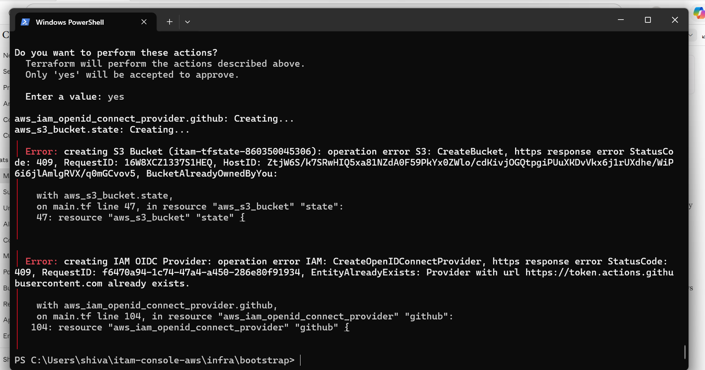
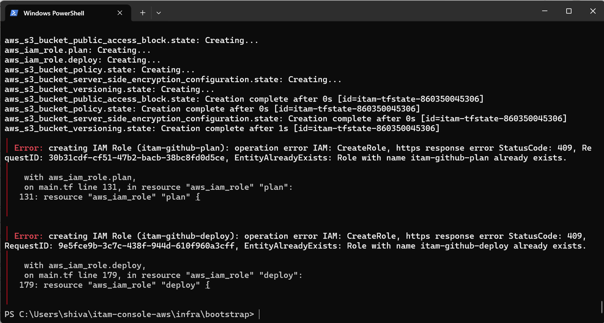
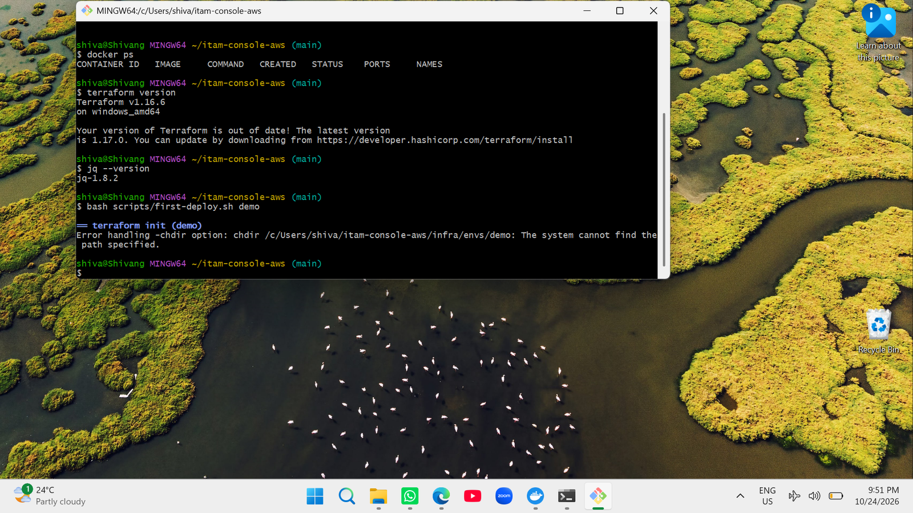
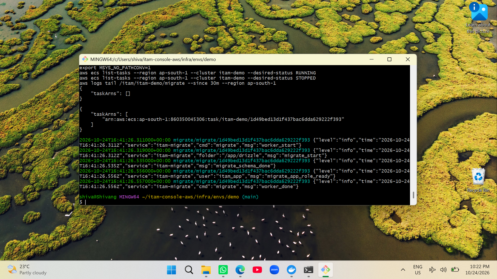

# Troubleshooting log (real issues from the first AWS deployment)

| Symptom | Cause | Fix | Evidence |
|---|---|---|---|
| Bootstrap `apply`: `BucketAlreadyOwnedByYou`, OIDC provider `EntityAlreadyExists` | Resources left by an earlier attempt | `terraform import` the bucket and the GitHub OIDC provider |  |
| Bootstrap `apply`: IAM roles `EntityAlreadyExists` | Same | `terraform import aws_iam_role.plan itam-github-plan`, then `aws_iam_role.deploy itam-github-deploy` |  |
| `terraform -chdir` failed from Git Bash on Windows | Windows `terraform.exe` cannot read `/c/Users/...` paths | Scripts convert the project path with `cygpath -m` |  |
| Deploy script stopped after "database migration" | Ctrl+C in Git Bash stopped the script while it waited; migration itself had finished | Verified in CloudWatch logs, then continued with `scripts/deploy.sh` |  |
| CI `image` and `terraform` jobs failed in 2-3 s | Pinned `trivy-action@0.28.0` tag no longer exists | Moved to a `v`-prefixed release (see next row) | n/a |
| CI `app` job failed | `npm audit` flagged drizzle-orm (high) and zod (high) | Upgraded drizzle-orm to 0.45.4; zod (needs v4 migration) accepted and gated at critical | n/a |
| `deploy` workflow failed: "Credentials could not be loaded" | `AWS_DEPLOY_ROLE_ARN` GitHub variable not set | Set repository variables and the `demo` environment, then run the workflow manually | n/a |
| CI `image` and `terraform` jobs still failed at the Trivy step | `trivy-action` v0.33.x downloads Trivy v0.65.0, whose release asset Aqua has removed, so installation fails before any scan runs | Upgraded to `trivy-action@v0.36.0` (Trivy v0.70.0); image scan reports HIGH and gates on CRITICAL | n/a |
| `deploy` workflow: `Permission denied` on `scripts/deploy.sh` | Scripts were committed with mode 100644 | Workflow calls `bash scripts/deploy.sh`; modes set with `git update-index --chmod=+x` | n/a |
| `deploy` / `plan`: state written by a newer Terraform than the runner | Local runs used Terraform 1.16.6, workflows pinned 1.10.5 | Workflows pinned to 1.16.6 | n/a |
